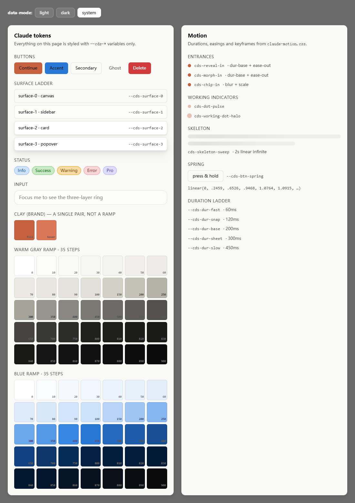
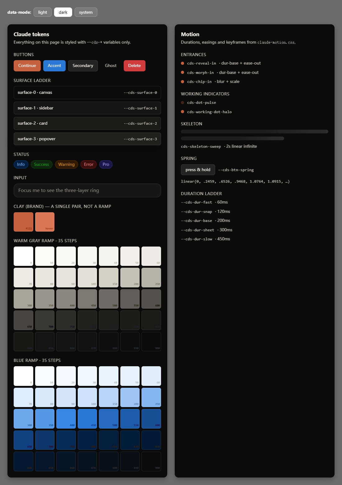

# Claude design tokens

Reverse-engineered design tokens from the Claude desktop application, published as
portable CSS custom properties and JSON.

Nothing here is copied source code. Every value was read out of the shipped,
publicly-downloadable application's stylesheet by the extractor in `scripts/`, so
you can regenerate and verify the whole set yourself.

| Light | Dark |
|---|---|
|  |  |

_`examples/preview.html` — every pixel styled from `--cds-*` variables only._

---

## What you get

| File | Contents |
|---|---|
| `dist/claude-tokens.css` | 955 `--cds-*` tokens, light + dark, scoped to `.cds-root` |
| `dist/claude-tokens-flat.css` | The same tokens with no theme switching (light only) |
| `dist/claude-motion.css` | Durations, easings, springs, and 58 `@keyframes` |
| `dist/claude-tokens-cq.css` | 18 tokens from the separate `cq-*` widget subsystem |
| `dist/claude-tokens-legacy.css` | 89 pre-Tailwind variables still referenced by the app |
| `data/tokens.json` | Every token, every definition, with selector + at-rule context |
| `data/roles.json` | 94 semantic roles with `var()` chains fully resolved to literals |
| `data/keyframes.json` | Every `@keyframes` block, verbatim |
| `data/report.json` | Conflicts, unresolved refs, per-file byte counts |

## Quick start

```html
<link rel="stylesheet" href="dist/claude-tokens.css">
<link rel="stylesheet" href="dist/claude-motion.css">

<div class="cds-root" data-mode="system">
  <button style="background: var(--cds-fill-brand); color: var(--cds-text-inverted)">
    Continue
  </button>
</div>
```

`data-mode` accepts `light`, `dark`, or `system`. `system` follows
`prefers-color-scheme`. Omitting the attribute gives you the light values.

Prefer a build step? Import the CSS and let your bundler handle it:

```js
import 'claude-design-tokens/dist/claude-tokens.css';
```

## The parts that actually matter

### Brand is clay, not blue

This is the single most commonly misread part of Claude's palette. The brand
accent is a warm terracotta, and the blue is a *separate* semantic accent used for
links and focus:

| Role | Token | Value |
|---|---|---|
| Brand fill | `--cds-fill-brand` | `#c6613f` (clay-emphasized) |
| Brand hover | `--cds-fill-brand-hover` | `#d97757` (clay) |
| Link / accent text | `--cds-text-accent` | `#184f95` |
| Accent fill | `--cds-fill-accent` | `#2a78d6` |
| Accent border | `--cds-border-accent` | `#86b6ef` |

Note the direction: **hover is lighter than the resting fill.** Most design
systems darken on hover; Claude warms up instead.

### Nine palettes, 35 steps each

`--cds-{clay,blue,gray,aqua,green,red,yellow,violet,magenta,orange}-{0..900}`.
Steps are not evenly spaced — the real ladder is
`0,10,20,30,40,50,60,70,80,90,100,150,200,250,300,350,400,450,500,...,900`,
with a `50`-increment cadence through the mid-range where the eye is most
sensitive.

The neutral ramp is *warm* gray (yellow-tinted), not pure gray. `--cds-gray-500`
is `#6d6b67`, not `#808080`.

### The alpha ladder is the interaction model

Rather than hardcoding hover colours, Claude drives almost every interactive
state off one alpha ramp over the neutral:

```css
--cds-alpha-1: hsl(from var(--cds-neutral-900) h s l / 5%);   /* ghost hover   */
--cds-alpha-2: hsl(from var(--cds-neutral-900) h s l / 10%);  /* selected      */
--cds-alpha-3: hsl(from var(--cds-neutral-900) h s l / 20%);  /* control hover */
--cds-alpha-4: hsl(from var(--cds-neutral-900) h s l / 35%);  /* disabled text */
```

Because the ramp is defined relative to `--cds-neutral-900`, it inverts
automatically in dark mode. Adopt this pattern and most of your dark theme is
free.

> These use relative colour syntax (`hsl(from ...)`), which needs Chrome 119+,
> Safari 16.4+, or Firefox 128+. The bundled `claude-tokens-legacy.css` includes
> the app's own pre-`color-mix` fallbacks.

### Focus rings are three stacked shadows

```css
--cds-focus-shadow:
  inset 0 0 0 1px var(--cds-page-bg),  /* inner: page-colour gasket  */
  0 0 0 1px var(--cds-fill-accent),    /* middle: 1px accent ring    */
  0 0 6px 1px var(--cds-bg-accent);    /* outer: 6px soft glow       */
```

The inner gasket is the interesting bit — it punches a hole in the ring so the
ring never touches the element it is highlighting. Use `box-shadow`, not
`outline`; `outline` will not follow the border radius.

### Surfaces are a ladder, and inner is lighter

`surface-0` is the canvas, then `1`, `2`, `3` step *up* in lightness as you go
deeper into the UI (page → sidebar → card → popover). In light mode the steps are
tiny (`#f9f9f7` → `#fcfcfb` → `#fff`); the depth comes from shadow and border
rather than from contrast.

### Dark mode compensates font weight

A quirk worth stealing: text rendered light-on-dark reads thinner than the same
weight dark-on-light. Claude corrects for this on the variable font's `wght`
axis, and the correction is a **uniform −40 on every step**:

| Named weight | Light `font-weight` | Dark `wght` axis | Δ |
|---|---|---|---|
| regular | 400 | 360 | −40 |
| medium | 500 | 460 | −40 |
| semibold | 580 | 540 | −40 |
| bold | 600 | 560 | −40 |

Two details that make this work:

1. **The light values are never applied as a `wght` axis.** In light mode
   `--cds-font-wght-*` is `normal`, so the browser uses the plain `font-weight`
   property. Only dark mode switches the mechanism to an explicit
   `font-variation-settings: "wght" N`.
2. **`grad` (grade) carries the optical weight instead.** Dark mode sets
   `--cds-font-grad-semibold: 180` and `--cds-font-grad-bold: 200`. Grade changes
   apparent weight without changing advance width, so text does not reflow when
   the theme changes.

```css
/* light: plain font-weight */
--cds-font-weight-medium: 500;
--cds-font-wght-medium: normal;

/* dark: axis override */
--cds-font-wght-medium: "wght" 460;
```

Note the semantic sizes: `semibold` is **580**, not 600, and `bold` is **600**,
not 700. The scale is tuned for the variable font, not the usual static ramp.

## Theme switching

The shipped stylesheet supports three mechanisms, all reproduced in the
generated CSS:

```css
.cds-root[data-mode='dark'] { /* explicit */ }

@media (prefers-color-scheme: dark) {
  .cds-root[data-mode='system'] { /* follow the OS */ }
}
```

There is also `.cds-dark-scope[data-mode='dark']`, a nested-dark container used
for embedded dark surfaces inside a light shell. If you need that, wrap the
subtree:

```html
<div class="cds-root" data-mode="light">
  <div class="cds-dark-scope" data-mode="dark">…</div>
</div>
```

## What is substituted, and why

Eight variables are referenced but never defined by the app — they are injected at
runtime or expected from the host. The generated CSS ships sane defaults for them,
so you do **not** have to supply anything:

| Variable | Refs | Shipped default |
|---|---|---|
| `--cds-rem-scale` | 110 | `1` — without it every `calc(Nrem * …)` is invalid and the whole type scale collapses |
| `--placeholder-reveal-delay` | 1 | `.5s` |
| `--cmp-chin-row-h` | 1 | `2rem` |
| `--cds-font-mono-override` | 2 | `initial` (empty, so the fallback chain applies) |
| `--font-anthropic-serif` | — | `ui-serif` (first slot only) |
| `--font-anthropic-mono` | 2 | `"SF Mono"` (first slot only) |
| `--font-anthropic-sans-display` | 1 | `ui-sans-serif` (first slot only) |
| `--_prose-leading`, `--tw-empty` | 5 | internal; ignored |

The `--font-anthropic-*` entries only fill the **first slot** of the stack. The
original definitions already end in a complete fallback chain, so the substitute
just needs to stop the leading name from being undefined — you still get
`ui-serif, Georgia, "Times New Roman", serif` and friends.

## Using it in a project

The tokens are just custom properties; you still apply them. A typical scope
element:

```css
.cds-root {
  font-family: var(--cds-font-sans);
  font-size: var(--cds-font-size-body);
  line-height: var(--cds-leading-body);
  color: var(--cds-text-primary);
  background: var(--cds-page-bg);
}
```

That yields `15px / 22px` body text, which is Claude's actual setting — not the
browser's 16px default.

## What you cannot reproduce

Two things are deliberately absent because they are Anthropic's assets, not
measurements. Both have good substitutes:

### Fonts

`--cds-font-sans` resolves to a plain system stack with CJK fallbacks built in, so
body text is fine. The distinctive faces are not included:

| Token | Ships as | Substitute |
|---|---|---|
| `--cds-font-sans` | system stack + CJK | already good; no action |
| `--cds-font-voice` | `ui-serif, Georgia, …` | a serif with similar warmth — Source Serif 4, Newsreader, or Spectral |
| `--cds-font-mono` | `"SF Mono", ui-monospace, …` | JetBrains Mono, IBM Plex Mono, or Geist Mono |

Anthropic's typefaces are variable fonts with a `grad` axis, which is why the dark
mode weight correction works. If you substitute a static font, the `-40` wght
nudge has nowhere to go; either accept slightly heavier dark text or pick a
variable font and map `grad` yourself.

### Icons

The icon font is entirely absent — **there is no icon set in this repo.** Every
icon must come from elsewhere. The relevant tokens still apply:

| Token | Use |
|---|---|
| `--cds-icon` | icon box size (follows the density ladder) |
| `--cds-opacity-icon-secondary` | de-emphasis for a two-tone secondary layer |
| `--cds-text-secondary` | default icon colour |

Lucide and Phosphor are the closest in weight and corner treatment. Set
`stroke-width` to roughly `1.5` at 16px to match Claude's optical weight.

### The 4% that will not resolve

Of 281 `var()` references in the generated CSS, 271 resolve. The remaining 10 are
internal component hooks (`--cds-font-wght-body`, `--cds-font-axis-wght-header`,
`--cds-text-stays-secondary`, …) used by specific widgets. They do not affect
colour, spacing, radius, shadow, motion, or theming.

## What is not here

- **No font binaries.** Not redistributable.
- **No icon font.** `anthropicons` is a proprietary asset.
- **No component source.** This is a values dump, not a component library.
- **No application logic.** Interaction behaviour cannot be read out of CSS;
  anything you see documented as behaviour is marked as an inference.

## Regenerating

```bash
npm install
npm run extract     # read the installed app → data/
npm run build       # data/ → dist/
npm run verify      # load dist/ in a real browser and assert the switch works
```

`npm run extract` auto-detects the newest Claude install. To point it elsewhere:

```bash
node scripts/extract.mjs --asar "C:/path/to/app.asar"
```

Every output file records the source `asar` SHA-256, so you can tell exactly
which build a given dump came from.

## Verified against

| | |
|---|---|
| Product | Claude `2.42304.0` (`@ant/desktop`) |
| ASAR SHA-256 | `8f4d3dec5e4f3ddffb150321060b18807d83a40f3a65618fe4f29325379da9db` |
| ASAR size | 49,338,428 bytes |
| Stylesheets parsed | 16 (339,374 bytes) |
| Variables | 1,142 |
| `@keyframes` | 58 |

## Documentation

| Doc | Contents |
|---|---|
| [`docs/TOKENS.md`](docs/TOKENS.md) | Every variable, semantic roles, full palettes |
| [`docs/MOTION.md`](docs/MOTION.md) | Durations, easings, springs, all 58 keyframes |
| [`docs/TYPOGRAPHY.md`](docs/TYPOGRAPHY.md) | Type scale, density ladders, dark-weight correction |
| [`docs/ICON-ANIMATION.md`](docs/ICON-ANIMATION.md) | How the icon font animates glyphs with a custom variation axis — with a runnable synthetic demo |

## Licence

The extraction tooling in `scripts/` and `src/` is MIT. The extracted *values*
describe a third party's visual design; see [NOTICE.md](NOTICE.md).

---

## Implementation notes for anyone writing their own extractor

Two things cost real time here. Both are easy to get subtly wrong.

### 1. The ASAR data offset is not `16 + jsonLength`

ASAR wraps its JSON header in a Chromium `Pickle`, and the payload is padded to a
4-byte boundary. The file data starts at:

```
baseOffset = 8 + headerSize        // headerSize = UInt32LE at byte 4
```

Using `16 + jsonLength` shifts every read by the padding — 2 bytes on the build
tested here. Text files then gain a stray `};` prefix, which looks like
"malformed JSON" and tempts you into writing a string-stripping workaround. Binary
entries are worse: a `woff2` silently loses its `wOF2` magic and becomes
unparseable. Read the header, assert it starts with `{`, and compute the offset
from `headerSize`.

### 2. `:not()` breaks naive theme detection

```css
[data-mode=dark] .cds-root:not([data-mode=light]):not([data-mode=system]) { … }
```

That is a **dark** rule, but a substring search for `light` matches inside the
negation and files it under light. Strip `:not(...)` sub-expressions before
looking for theme hints.

### 3. Base tokens are aliases, not literals

```css
.cds-root                     { --cds-font-size-body: var(--cds-font-size-body--lg); }
.cds-root[data-density=comfortable] { --cds-font-size-body--lg: calc(.9375rem * …); }
```

A one-level `var()` resolver reports `var(--cds-font-size-body--lg)` and stops.
Follow the chain to the end, or the whole type scale comes out as aliases.

### 4. `@supports` pairs are not conflicts

Tailwind emits a plain fallback plus a modern value inside
`@supports (color: color-mix(in lab, red, red))`. Both are correct. Group
definitions by `(theme, selector, at-rule chain)` so these land in a
"progressive enhancement" bucket instead of a false conflict list.
