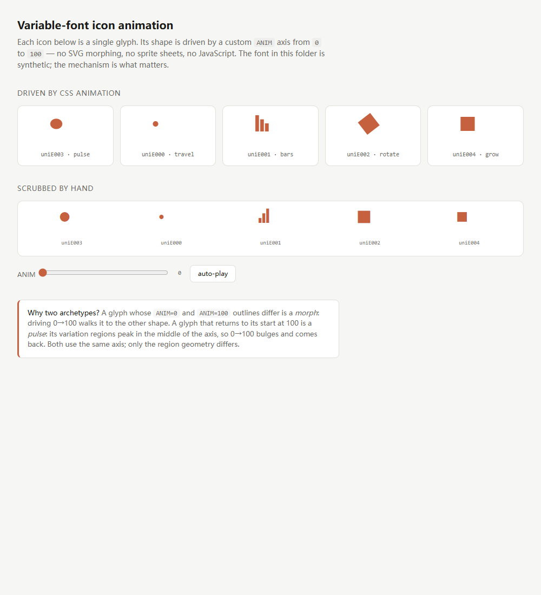
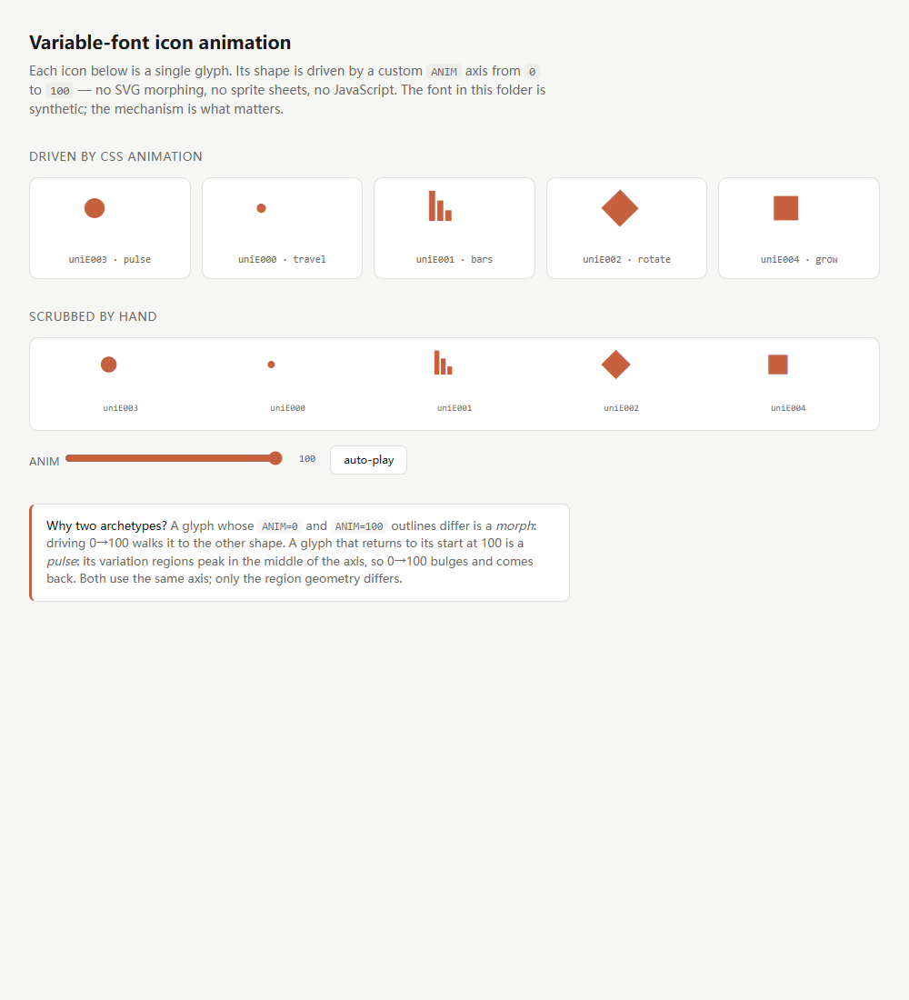

# Animating icons with a variable font

How Claude's icon font animates 24 of its glyphs with **zero JavaScript, zero
sprite sheets, and zero SVG morphing** — and how to build the same thing.

This is a write-up of a mechanism, not a copy of an asset. Every glyph in the demo
is generated by [`make-demo-font.py`](../examples/icon-animation/make-demo-font.py)
from circles, squares and bars. Nothing here redistributes Anthropic's artwork.

| `ANIM = 0` | `ANIM = 100` |
|---|---|
|  |  |

_The bundled demo font. `uniE003` (pulse) looks identical in both columns — that
is the point of archetype B._

---

## The short version

The icon font declares two extra variation axes beyond the usual `wght`/`opsz`:

| Axis | Range | Registered name | Purpose |
|---|---|---|---|
| `ANIM` | 0 → 100 | `Animation` | primary animation driver |
| `ANM2` | 0 → 100 | `Animation loop` | second, independent channel |

The names come from the font's own `name` table, so "Animation loop" is the
vendor's label, not an inference. Only 2 of the animated glyphs use `ANM2`; the
rest are driven by `ANIM` alone.

Animation is then just:

```css
.icon { font-variation-settings: 'ANIM' 0; }

@keyframes pulse {
  0%, 100% { font-variation-settings: 'ANIM' 0; }
  50%      { font-variation-settings: 'ANIM' 100; }
}
```

Because the glyph is a variable font outline, the browser interpolates the
**control points themselves**. You get smooth, sub-pixel-accurate shape
interpolation at whatever frame rate the compositor manages, and the icon still
costs one glyph slot and one font file.

## What the axes actually look like

Measured from the shipped font:

```
wght  400 / 400 / 700     Weight
opsz   12 /  20 /  32     Optical Size
ANIM    0 /   0 / 100     Animation
ANM2    0 /   0 / 100     Animation loop
```

Both animation axes default to `0`, so a font that is never touched renders at
rest. That is the important design decision: **the animated state is opt-in.**

Coverage: **24 of 869 glyphs** carry animation deltas, and 395 codepoints are
mapped — all inside the private-use range `U+E000`–`U+E18C`. Of the 24 animated
glyphs only 12 have a mapped codepoint; the other 12 are reachable only through
substitution.

## Two archetypes

Not all animated glyphs behave the same way, and the difference is not cosmetic —
it determines how you drive the axis.

### Archetype A — morph

`ANIM=0` and `ANIM=100` are two different shapes. Driving 0→100 walks from one to
the other and **holds** at 100.

```
ANIM=  0  ▁▃▅   (bars ascending)
ANIM= 50  ▅▅▅   (mid)
ANIM=100  ▅▃▁   (bars descending)
```

Measured displacement from the rest outline, for a real morph glyph:

```
ANIM= 10   32.5
ANIM= 30   97.7
ANIM= 50  163.0
ANIM= 70  228.5
ANIM=100  327.0      <- monotonic, no return
```

**22 of the 24** animated glyphs are morphs.

### Archetype B — pulse

`ANIM=0` and `ANIM=100` are **the same shape**. The variation regions are declared
to peak in the *middle* of the axis, so driving 0→100 makes the shape bulge and
return.

```
ANIM=  0  ○   (rest)
ANIM= 50  ●   (peak)
ANIM=100  ○   (back to rest)
```

Measured displacement:

```
ANIM= 10   32.5
ANIM= 20   53.0
ANIM= 50   53.0
ANIM= 80   53.0
ANIM= 90   32.5
ANIM=100    0.0      <- returns to zero
```

**2 of the 24** are pulses. The plateau in the middle is several overlapping
regions stacking.

> This is why a naive check for "did the outline move?" is misleading: a pulse
> glyph measured only at 0 and 100 looks completely static. You have to sample the
> middle of the axis.

## How the mid-range region is built

This is the whole trick, so it is worth seeing concretely.

`gvar` variation tuples carry a **support region** — a triple `(start, peak, end)`
per axis. A tuple's scalar contribution is 0 outside `[start, end]`, 1 at `peak`,
and ramps linearly in between.

A full-range tuple:

```
ANIM: (0.0, 1.0, 1.0)
       │    │    └── end   = axis max
       │    └─────── peak  = axis max  → ramps 0→1 across the whole axis
       └──────────── start = axis min
```

A mid-range tuple:

```
ANIM: (0.0, 0.5, 1.0)
       │    │    └── end   = axis max
       │    └─────── peak  = midpoint → 1 at the middle, 0 at both ends
       └──────────── start = axis min
```

Real pulse glyphs use narrow, staggered mid-range tuples — several of them, each
peaking at a slightly different point, which is what produces a staggered
sequence rather than one simultaneous bulge:

```
ANIM: (0.000, 0.163, 0.837)
ANIM: (0.163, 0.837, 1.000)
ANIM: (0.093, 0.256, 0.744)
ANIM: (0.256, 0.744, 0.907)
ANIM: (0.186, 0.349, 0.651)
ANIM: (0.349, 0.651, 0.814)
ANIM: (0.279, 0.442, 0.558)
ANIM: (0.442, 0.558, 0.721)
```

Read the peaks: `0.163, 0.837, 0.256, 0.744, 0.349, 0.651, 0.442, 0.558`. They are
laid out as symmetric pairs marching toward the centre, so different sub-shapes
light up in sequence as `ANIM` sweeps 0→100 and back.

## Building one yourself

[`make-demo-font.py`](../examples/icon-animation/make-demo-font.py) builds a
five-glyph demo font from scratch. The relevant parts:

### 1. Declare the axis

```python
ax = AxisDescriptor()
ax.minimum, ax.default, ax.maximum = 0, 0, 100
ax.name = ax.tag = "ANIM"
ds.addAxis(ax)
```

Default `0` means the font renders at rest until you ask otherwise.

### 2. Supply a master at the middle

This is the step people miss. `fontTools`' `varLib.build` derives regions from the
masters you give it. Two masters (0 and 100) can only produce a full-range region
— a morph. To get a pulse you need **three**, and the middle one has to actually
differ:

```python
for loc, font, fname in ((0, rest, "rest.ttf"),
                         (50, peak, "peak.ttf"),
                         (100, end, "end.ttf")):
    ...
```

Two traps here:

- If the middle master equals the **end** shape, the axis is flat from 50 to 100.
- If the middle master equals the **rest** shape for a morph glyph, the first half
  is flat instead.

The middle master must be the genuine midpoint for a morph, and the genuine bulge
for a pulse.

### 3. Drive it from CSS

```css
@keyframes pulse {
  0%, 100% { font-variation-settings: 'ANIM' 0; }
  50%      { font-variation-settings: 'ANIM' 100; }
}
```

`font-variation-settings` **is animatable** — it is not a discrete property. No JS,
no `requestAnimationFrame`.

## Production details worth knowing

### 1. Reset the axis when unused

Claude's stylesheet does this explicitly:

```css
[data-cds=Icon]:not(svg):not([data-cds-anim]) {
  font-variation-settings: normal;
}
```

Without it, a `font-variation-settings` value inherits into child elements and
silently keeps animating things that should be still. Reset is not optional.

### 2. Icon fonts need more than a font

```css
[data-cds=Icon]:not(svg) {
  font-family: var(--font-anthropicons, Anthropicons-Variable);
  font-feature-settings: "liga" 0;   /* kill ligatures: codepoints are literal */
  font-optical-sizing: auto;
  width: 1em; height: 1em;
  font-style: normal;
  line-height: 1;
  display: flex;
}
```

`font-feature-settings: "liga" 0` matters: glyphs are addressed by private-use
codepoint, so a ligature substitution could collapse two adjacent icons into one.

### 3. RTL mirroring

```css
:root[dir=rtl] [data-cds=Icon][data-cds-mirror]:is(:lang(ar), :lang(he), …) {
  transform: scaleX(-1);
}
```

Mirroring is opt-in per icon via `data-cds-mirror`, and gated on language rather
than direction alone, because many scripts are written RTL without wanting glyphs
flipped.

### 4. Two-tone icons via a nested layer

```css
[data-cds=Icon] > [data-cds-icon-layer=secondary] {
  color: currentColor;
  width: 1em;
  margin-inline-end: -1em;    /* pull back over the primary layer */
}
```

A secondary layer is overlaid on the primary with a negative margin and
de-emphasised with `color-mix` on `--cds-opacity-icon-secondary`. A cheap way to
get two-tone from a single-colour font.

### 5. Codepoints are private-use only

All 395 mapped codepoints are in `U+E000`–`U+E18C`. That is the standard
private-use-area convention for icon fonts: it guarantees no collision with real
text, at the cost of being meaningless outside the font.

## Gotchas

**Topology must match across masters.** If two masters differ in point *count*,
`varLib` will refuse or produce garbage. Every animated glyph must keep an
identical point count and contour order across all masters — design the rest and
end shapes as the same topology from the start.

**Sub-pixel deltas disappear.** `gvar` stores deltas as integers. Small differences
round away and the glyph looks static at low `ANIM` values. The staggered regions
above exist partly to work around this.

**`font-optical-sizing: auto` can interfere.** If your font has an `opsz` axis the
browser drives it automatically, and it composes with `ANIM`. Set
`font-optical-sizing: none` if you want deterministic shapes.

**Not all renderers agree.** `font-variation-settings` animation is well supported
in Chromium and WebKit; Firefox works but has historically been slower to
interpolate custom axes. Test the actual browser matrix you target.

## Checking a font yourself

```bash
pip install fonttools brotli

python - <<'PY'
from fontTools.ttLib import TTFont
from fontTools.varLib.instancer import instantiateVariableFont

f = TTFont('your-icon-font.woff2')
print('axes:', [(a.axisTag, a.minValue, a.defaultValue, a.maxValue) for a in f['fvar'].axes])

gvar = f['gvar']
animated = [g for g, vs in gvar.variations.items()
            if any({'ANIM', 'ANM2'} & set(v.axes) for v in vs)]
print(f'{len(animated)} animated glyphs of {len(f.getGlyphOrder())}')

def points(glyph, v):
    inst = instantiateVariableFont(TTFont('your-icon-font.woff2'),
                                   {'ANIM': v}, inplace=False)
    return list(inst['glyf'][glyph].coordinates)

rest, mid, end = points(animated[0], 0), points(animated[0], 50), points(animated[0], 100)
print('archetype:', 'morph' if rest != end else ('pulse' if rest != mid else 'static'))
PY
```

That last line is the whole diagnostic. Sample the middle.

## See it run

```
examples/icon-animation/index.html
```

Open it directly — no server needed. It loads the synthetic demo font, animates
five glyphs with CSS keyframes, and includes a manual scrub slider so you can step
`ANIM` from 0 to 100 and watch each shape interpolate.

To rebuild the font:

```bash
pip install fonttools brotli
python examples/icon-animation/make-demo-font.py
```
